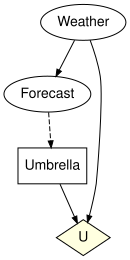

# Open influence diagrams and composition
Simon Frost

- [Overview](#overview)
- [Setup](#setup)
- [Splitting the umbrella problem](#splitting-the-umbrella-problem)
- [The typed-interface rule](#the-typed-interface-rule)
- [Composing the umbrella problem
  back](#composing-the-umbrella-problem-back)
- [Semantics for a fixed strategy: reward
  kernels](#semantics-for-a-fixed-strategy-reward-kernels)
  - [Functoriality, checked
    numerically](#functoriality-checked-numerically)
- [A first look at optimisation](#a-first-look-at-optimisation)
- [Summary](#summary)
- [References](#references)

## Overview

An influence diagram adds decisions and utilities to a Bayesian network
([Howard and Matheson 2005](#ref-HowardMatheson2005)): a decision is a
variable whose value is chosen by a policy that reads the decision’s
information set, and the utilities score the outcome. An *open*
influence diagram has an interface as well. Some variables are inputs,
provided by the environment, and some are outputs, offered to it. As for
open Bayesian networks ([Fong 2012](#ref-Fong2012)), the interface is a
structured cospan ([Baez and Courser 2020](#ref-BaezCourser2020)): the
apex is the influence diagram, the two feet are `VariableSpace`s, and
composition glues the outputs of one diagram to the inputs of the next
by a pushout.

A decision problem needs one more thing at the boundary. A later
decision may read a variable that crosses the interface only if that
variable is remembered information, not hidden state. So every interface
variable carries an observability flag, `:observed` or `:hidden`, and
two interfaces match only if their flags do. This vignette splits the
umbrella problem into a chance component and a decision component, shows
what the typed-interface rule refuses, composes the pieces back with
`compose`, `glue`, `otimes` and `oapply`, and checks numerically that
the semantics, a reward kernel for each fixed strategy, sends
composition to composition.

## Setup

The umbrella problem has a weather variable, a forecast that depends on
it, and a decision, whether to take the umbrella, made on the forecast.
The utility `U` scores the weather and the decision.

``` julia
using CategoricalInfluenceDiagrams

m = umbrella_model()
umbrella = syntax(m)
(variables = variable_names(umbrella), decisions = decision_names(umbrella),
 information = information_names(umbrella, :Umbrella), utilities = utility_names(umbrella))
```

    (variables = [:Weather, :Forecast, :Umbrella], decisions = [:Umbrella], information = [:Forecast], utilities = [:U])

``` julia
to_graphviz(umbrella; states = false)
```



## Splitting the umbrella problem

Cut the diagram between the forecast and the decision. The chance
component generates `Weather` and `Forecast` and offers both; the
decision component takes both as inputs, holds the decision and the
utility. In the decision component neither input has a mechanism
(`closed = false` allows that).

``` julia
chance_diagram = influence_diagram(:Weather => [:sunny, :rainy],
                                   :Forecast => [:sunny, :cloudy, :rainy];
                                   mechanisms = [:Weather => (), :Forecast => :Weather],
                                   closed = false)
decide_diagram = influence_diagram(:Weather => [:sunny, :rainy],
                                   :Forecast => [:sunny, :cloudy, :rainy],
                                   :Umbrella => [:take, :leave];
                                   decisions = [:Umbrella => :Forecast],
                                   utilities = [:U => (:Weather, :Umbrella)],
                                   closed = false)
nothing # hide
```

`Open` names the interface, and its keyword `observed` names the
interface variables a decision may read. The weather crosses the
boundary because the utility needs it, but no one sees it before
deciding: it stays hidden. The forecast is observed.

``` julia
A = Open(chance_diagram; outputs = [:Weather, :Forecast], observed = [:Forecast])
B = Open(decide_diagram; inputs = [:Weather, :Forecast], observed = [:Forecast])
println(A)
println(B)
```

    OpenInfluenceDiagram(2 variables, 2 mechanisms, 0 decisions, 0 utilities; Symbol[] -> [:Weather, :Forecast!])
    OpenInfluenceDiagram(3 variables, 0 mechanisms, 1 decisions, 1 utilities; [:Weather, :Forecast!] -> Symbol[])

An observed variable is printed with a `!`. The flags are part of the
interface:

``` julia
output_observability(A), input_observability(B), observed_inputs(B)
```

    ([:hidden, :observed], [:hidden, :observed], [:Forecast])

`dom` and `codom` return the interfaces as objects of the category, a
`VariableSpace` with one flag per variable:

``` julia
codom(A) == dom(B)
```

    true

The default is that everything is hidden. It is the conservative choice:
an interface carries information only where it says so. An open Bayesian
network embeds as an open influence diagram with no decisions and every
interface variable hidden:

``` julia
bn_piece = Open(bayesnet(:Weather => [:sunny, :rainy],
                         :Forecast => [:sunny, :cloudy, :rainy];
                         mechanisms = [:Weather => (), :Forecast => :Weather]);
                outputs = [:Weather, :Forecast])
embedded = OpenInfluenceDiagram(bn_piece)
output_observability(embedded)
```

    2-element Vector{Symbol}:
     :hidden
     :hidden

## The typed-interface rule

The typed-interface rule of open Bayesian networks extends to decisions
and utilities. Every variable has at most one generator, a chance
mechanism or a decision; an input has no generator in the apex; a
decision reads only internal variables or *observed* inputs; a utility
may read any variable of the apex; the causal-plus-information graph is
acyclic; and composition preserves no-forgetting. `Open` checks the rule
and throws the first violation as a typed error.

A decision that reads a hidden input violates rule 3. Declaring the
forecast hidden leaves the umbrella decision reading a variable that,
across the boundary, no one has seen:

``` julia
try
    Open(decide_diagram; inputs = [:Weather, :Forecast])
catch e
    sprint(showerror, e)
end
```

    "DiagramInterfaceError: rule 3 (a decision reads only internal or observed input-foot variables) is violated: decision :Umbrella has the hidden input :Forecast in its information set; declare it observed or remove the arc"

An input that has a mechanism violates rule 2: the weather would then be
generated twice once the components are glued.

``` julia
try
    Open(chance_diagram; inputs = [:Weather], outputs = [:Forecast])
catch e
    sprint(showerror, e)
end
```

    "DiagramInterfaceError: rule 2 (an input-foot variable has no generator in the apex) is violated: input :Weather is generated by the mechanism :Weather_mechanism"

A variable without a generator must be an input, as for an open network.
Here the weather has no mechanism in the decision component and is left
off the interface:

``` julia
try
    Open(decide_diagram; inputs = [:Forecast], observed = [:Forecast])
catch e
    sprint(showerror, e)
end
```

    "InterfaceError: rule 3 (every mechanism-free apex variable is an input) is violated by variable(s) Weather (ids 1)"

The flags are checked at composition as well. A chance component that
hides the forecast does not match a decision component that expects to
observe it, even though the names and states agree:

``` julia
A_hidden = Open(chance_diagram; outputs = [:Weather, :Forecast])
try
    compose(A_hidden, B)
catch e
    sprint(showerror, e)
end
```

    "ObservabilityMismatchError: compose: outputs(A) vs inputs(B): variable :Forecast at position 2 is :hidden on the left but :observed on the right; glued interface variables must agree on observability"

Rule 6 concerns composites. In the oil wildcatter’s problem a test
decision comes before a drilling decision. Split between them, each
component has no-forgetting on its own, but a drilling decision that
reads the test result and not whether a test was made forgets an earlier
decision once the two are composed:

``` julia
test_part = Open(influence_diagram(:Oil => [:dry, :wet], :Test => [:test, :skip],
                                   :Result => [:pos, :neg, :none];
                                   mechanisms = [:Oil => (), :Result => (:Oil, :Test)],
                                   decisions = [:Test => Symbol[]],
                                   utilities = [:TestCost => :Test], closed = false);
                 outputs = [:Oil, :Test, :Result], observed = [:Test, :Result])
drill_diagram(information) =
    influence_diagram(:Oil => [:dry, :wet], :Test => [:test, :skip],
                      :Result => [:pos, :neg, :none], :Drill => [:drill, :dont];
                      decisions = [:Drill => information],
                      utilities = [:Payoff => (:Oil, :Drill)], closed = false)
forgetful = Open(drill_diagram((:Result,)); inputs = [:Oil, :Test, :Result],
                 observed = [:Test, :Result])
try
    compose(test_part, forgetful)
catch e
    sprint(showerror, e)
end
```

    "NoForgettingError: the components have no-forgetting but the composite does not: decision :Drill comes after decision :Test but does not know :Test (the information arc :Test -> :Drill is missing); pass :Test across the boundary as an observed variable and add it to the information set of :Drill, or compose with `no_forgetting = false`"

With the test passed on as an observed variable and read by the drilling
decision, the composite is the oil wildcatter’s diagram:

``` julia
drill_part = Open(drill_diagram((:Test, :Result)); inputs = [:Oil, :Test, :Result],
                  observed = [:Test, :Result])
is_isomorphic(apex(compose(test_part, drill_part)), two_stage_diagram())
```

    true

## Composing the umbrella problem back

`compose` (or `⋅`) is strict sequential composition: the outputs of the
first diagram must equal the inputs of the second, position by position,
with the same states and the same flags. The composite is the pushout of
the two apexes along the shared foot. Here it has no interface left, and
it is the umbrella diagram again:

``` julia
C = compose(A, B)
println(C)
is_isomorphic(apex(C), umbrella_diagram()), A ⋅ B == C
```

    OpenInfluenceDiagram(3 variables, 2 mechanisms, 1 decisions, 1 utilities; Symbol[] -> Symbol[])

    (true, true)

`glue` composes along explicit pairs of names, which may differ (the
glued variable keeps its name from the first diagram), and leaves the
rest of the interface open. Renaming the decision component’s forecast
to `Signal` and gluing along both variables gives the umbrella diagram
again; gluing only the forecast, with the decision component’s weather
renamed `Season`, leaves the two weather variables on the interface:

``` julia
B_signal = Open(rename_variable(decide_diagram, :Forecast => :Signal);
                inputs = [:Weather, :Signal], observed = [:Signal])
G = glue(A, B_signal; along = [:Weather => :Weather, :Forecast => :Signal])
B_season = Open(rename_variable(decide_diagram, :Weather => :Season);
                inputs = [:Season, :Forecast], observed = [:Forecast])
H = glue(A, B_season; along = [:Forecast => :Forecast])
println(H)
is_isomorphic(apex(G), umbrella_diagram())
```

    OpenInfluenceDiagram(4 variables, 2 mechanisms, 1 decisions, 1 utilities; [:Season] -> [:Weather])

    true

`otimes` (or `⊗`) places diagrams side by side, concatenating the
interfaces and their flags:

``` julia
T = A ⊗ B
println(T)
dom(T) == dom(A) ⊗ dom(B), codom(T) == codom(A) ⊗ codom(B)
```

    OpenInfluenceDiagram(5 variables, 2 mechanisms, 1 decisions, 1 utilities; [:Weather, :Forecast!] -> [:Weather, :Forecast!])

    (true, true)

`oapply` composes along an undirected wiring diagram written with
`@relation`. Each box receives a diagram, its ports are the interface
variables (inputs first), and the interfaces meeting at a junction are
compared, flags included, before the colimit is taken:

``` julia
uwd = @relation () begin
    chance(weather, forecast)
    decide(weather, forecast)
end
O = oapply(uwd, Dict(:chance => A, :decide => B))
is_isomorphic(apex(O), umbrella_diagram())
```

    true

The identity on an interface is the diagram that holds the interface’s
variables and nothing else; composing with it changes nothing up to
isomorphism:

``` julia
is_isomorphic(apex(compose(A, id(codom(A)))), apex(A))
```

    true

## Semantics for a fixed strategy: reward kernels

Fix a deterministic strategy. An open diagram `X → Y` then denotes a
reward kernel `(K, W)`: `K(y | x)` is the probability of reaching the
output state `y` from the input state `x`, and `W(y, x)` the expected
reward earned on the way, weighted by the probability of reaching `y`.
Reward kernels compose by `(K₁, W₁) ; (K₂, W₂) = (K₁K₂, W₁K₂ + K₁W₂)`:
the reward of the composite is what the first component earns, carried
forward by the second component’s kernel, plus what the second earns
from where the first left off. This is kernel composition over the
expectation semiring `(p, r)·(q, s) = (pq, ps + rq)`.

`interpret` computes the reward kernel of an open diagram from the
tables, which it looks up by kernel reference or by variable name, and a
strategy. The chance component has no decision, so its strategy is
empty, and no utility, so its reward is zero:

``` julia
ks = Dict(x => kernel(m, x) for x in (:Weather, :Forecast))
us = bound_utilities(m)
rA = interpret(A, ks, us, Strategy())
println(rA)
kernel_matrix(kernel(rA)), reward_matrix(rA)
```

    RewardKernel(Symbol[] → [:Weather, :Forecast])

    ([0.48999999999999994; 0.045; … ; 0.06999999999999999; 0.18;;], [0.0; 0.0; … ; 0.0; 0.0;;])

The decision component, under the strategy that takes the umbrella only
on a rainy forecast, is a reward kernel from the six joint states of
`(Weather, Forecast)` to the empty interface: the probability part
discards its input, and the reward part is the utility of the weather
and of the action the policy picks for the forecast.

``` julia
σ = Strategy(:Umbrella => deterministic_policy(m, :Umbrella, [:leave, :leave, :take]))
rB = interpret(B, ks, us, σ)
println(rB)
reward_matrix(rB)
```

    RewardKernel([:Weather, :Forecast] → Symbol[])

    1×6 Matrix{Float64}:
     100.0  0.0  100.0  0.0  20.0  70.0

Their composite is a reward kernel from the empty interface to itself:
probability one, and a reward equal to the expected utility of the
strategy.

``` julia
r = compose(rA, rB)
(probability = only(kernel_matrix(kernel(r))), reward = reward(r)[],
 expected_utility = expected_utility(m, σ))
```

    (probability = 0.9999999999999998, reward = 76.99999999999999, expected_utility = 76.99999999999999)

### Functoriality, checked numerically

Functoriality says that interpreting the composite gives the composite
of the interpretations. The check runs over every deterministic strategy
of the umbrella decision, eight in all (a choice of action for each of
the three forecasts). For each, the reward kernel of `compose(A, B)` is
compared with the composite of the two reward kernels, and its reward
with the expected utility that `InfluenceDiagrams.jl` computes on the
closed composite, instantiated as an ordinary model:

``` julia
policies = all_deterministic_policies(:Umbrella, factors(information_space(m, :Umbrella)),
                                      only(factors(action_space(m, :Umbrella))))
closed_model = bind_utility(bind_kernel(InfluenceDiagramModel(apex(C)),
                                        [x => ks[x] for x in (:Weather, :Forecast)]),
                            :U => us[:U])
checks = map(policies) do p
    τ = Strategy(:Umbrella => p)
    whole = interpret(C, ks, us, τ)
    (actions = Tuple(policy_table(p)),
     functorial = whole ≈ compose(rA, interpret(B, ks, us, τ)),
     eu = reward(whole)[],
     oracle = expected_utility(closed_model, τ))
end
[(actions = c.actions, eu = round(c.eu; digits = 2)) for c in checks]
```

    8-element Vector{@NamedTuple{actions::Tuple{Symbol, Symbol, Symbol}, eu::Float64}}:
     (actions = (:take, :take, :take), eu = 35.0)
     (actions = (:leave, :take, :take), eu = 71.05)
     (actions = (:take, :leave, :take), eu = 40.95)
     (actions = (:leave, :leave, :take), eu = 77.0)
     (actions = (:take, :take, :leave), eu = 28.0)
     (actions = (:leave, :take, :leave), eu = 64.05)
     (actions = (:take, :leave, :leave), eu = 33.95)
     (actions = (:leave, :leave, :leave), eu = 70.0)

Every strategy passes both checks:

``` julia
all(c -> c.functorial && c.eu ≈ c.oracle, checks)
```

    true

The tensor is preserved too: the reward kernel of `A ⊗ B` is the tensor
of the two, `(K₁ ⊗ K₂, W₁ ⊗ K₂ + K₁ ⊗ W₂)`.

``` julia
interpret(A ⊗ B, ks, us, σ) ≈ otimes(rA, rB)
```

    true

So is gluing, which is serial composition along part of an interface,
and `oapply`, which builds the same pushout from a wiring diagram:

``` julia
interpret(G, ks, us, σ) ≈ r, interpret(O, ks, us, σ) ≈ r
```

    (true, true)

## A first look at optimisation

The closed composite is an ordinary influence diagram, so the solvers of
`InfluenceDiagrams.jl` apply to it. `optimize` hands it to them:

``` julia
sol = optimize(C, ks, us)
sol.expected_utility, policy_table(sol.strategy[:Umbrella])
```

    (77.00000000000001, [:leave, :leave, :take])

The open decision component has no expected utility of its own: it has
one only in a context, a law on its inputs and a value for its outputs.
`boundary_law` gives the joint law of `(Weather, Forecast)` that the
chance component induces, and against it `contextual_optimize` finds the
same optimum:

``` julia
ν = boundary_law(A, ks, us, Strategy())
local_sol = contextual_optimize(B, ks, us; prior = ν)
local_sol.expected_utility ≈ sol.expected_utility, local_sol.strategy == sol.strategy
```

    (true, true)

That optimising a component against the context its neighbours induce
recovers the optimum of the whole, while optimising it against any other
context need not, is the subject of the third vignette, [Why
optimisation does not
compose](03_why_optimisation_does_not_compose.md).

## Summary

An open influence diagram is a structured cospan of influence diagrams
whose interface variables are flagged observed or hidden. The
typed-interface rule refuses an input with a generator, a free variable
off the interface, a decision that reads a hidden input, and a composite
that forgets an earlier decision; glued interfaces must agree on
observability as well as on names and states. `compose`, `glue`,
`otimes` and `oapply` are pushouts and coproducts of ACSets with the
rule checked again on the result. For a fixed strategy, `interpret`
sends each of them to the corresponding operation on reward kernels, and
on a closed composite the reward is the expected utility of the
instantiated diagram. The next vignette, [Composing a management
decision with a zoo
network](02_management_decision_with_zoo_network.md),
applies the same constructions to an ecological network from the model
zoo.

## References

```@raw html
<div id="refs" class="references csl-bib-body hanging-indent">
```

```@raw html
<div id="ref-BaezCourser2020" class="csl-entry">
```

Baez, John C., and Kenny Courser. 2020. “Structured Cospans.” *Theory
and Applications of Categories* 35 (48): 1771–822.

```@raw html
</div>
```

```@raw html
<div id="ref-Fong2012" class="csl-entry">
```

Fong, Brendan. 2012. *Causal Theories: A Categorical Perspective on
Bayesian Networks*. <https://arxiv.org/abs/1301.6201>.

```@raw html
</div>
```

```@raw html
<div id="ref-HowardMatheson2005" class="csl-entry">
```

Howard, Ronald A., and James E. Matheson. 2005. “Influence Diagrams.”
*Decision Analysis* 2 (3): 127–43.
<https://doi.org/10.1287/deca.1050.0020>.

```@raw html
</div>
```

```@raw html
</div>
```
