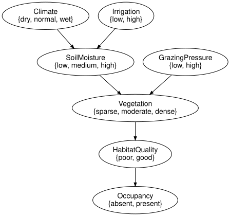
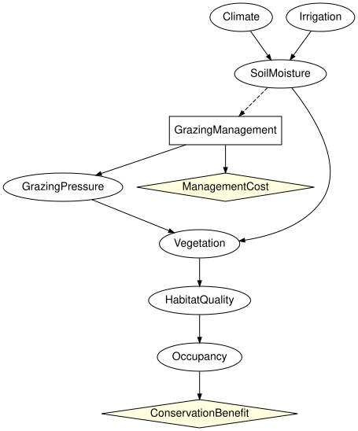

# Composing a management decision with a zoo network
Simon Frost

- [Overview](#overview)
- [Setup](#setup)
- [Opening the zoo network at a
  boundary](#opening-the-zoo-network-at-a-boundary)
- [A management component and a valuation
  component](#a-management-component-and-a-valuation-component)
- [Observability at the boundary](#observability-at-the-boundary)
- [Composing and optimising the closed
  composite](#composing-and-optimising-the-closed-composite)
- [Optimising the decision component in
  context](#optimising-the-decision-component-in-context)
- [Summary](#summary)
- [References](#references)

## Overview

Ecological Bayesian networks are often built first as descriptions of a
system, and a management decision is added later ([Marcot et al.
2006](#ref-Marcot2006); [Runge et al. 2011](#ref-Runge2011)). The usual
way to add it is to edit the network into one larger influence diagram.
With open influence diagrams the network can stay as it was published:
it is opened at a boundary, a separate component holds the decision, its
cost and how it acts on the system, and the pieces are composed. The
decision then sees exactly what the boundary declares observed, and
nothing else.

This vignette does that with the reference habitat network of the model
zoo of `EcologicalBayesianNetworks.jl`. The network models soil moisture
from climate and irrigation, and the vegetation, habitat quality and
occupancy of a species from soil moisture and grazing pressure. In the
zoo the grazing pressure is a root with a fixed prior. Here a manager
sets it instead, through a grazing decision made on the observed soil
moisture. The vignette opens the network at the boundary, attaches the
decision component, composes, optimises the closed composite, and then
optimises the decision component on its own against the context the
network induces on its boundary.

## Setup

`load_model` builds a model of the zoo. The reference habitat network is
built into the zoo under the MIT licence, so it needs no download, and
so is the SPEC section 46 grazing diagram, from which the decision
component borrows its numbers.

``` julia
using CategoricalInfluenceDiagrams
using EcologicalBayesianNetworks

zoo = ["reference_habitat_bn", "reference_grazing_id"]
[(name, model_info(name).licence, model_info(name).redistribution) for name in zoo]
```

    2-element Vector{Tuple{String, String, String}}:
     ("reference_habitat_bn", "MIT", "builtin")
     ("reference_grazing_id", "MIT", "builtin")

``` julia
habitat = load_model("reference_habitat_bn")
grazing = load_model("reference_grazing_id")
[x => states(syntax(habitat), x) for x in variable_names(syntax(habitat))]
```

    7-element Vector{Pair{Symbol, Vector{Symbol}}}:
             :Climate => [:dry, :normal, :wet]
          :Irrigation => [:low, :high]
        :SoilMoisture => [:low, :medium, :high]
     :GrazingPressure => [:low, :high]
          :Vegetation => [:sparse, :moderate, :dense]
      :HabitatQuality => [:poor, :good]
           :Occupancy => [:absent, :present]

``` julia
to_graphviz(syntax(habitat))
```



The kernels of the zoo network, keyed by variable name, are the tables
every component below reads:

``` julia
zoo_kernels = Dict{Symbol,FiniteKernel}(x => kernel(habitat, x)
                                        for x in variable_names(syntax(habitat)))
zoo_kernels[:GrazingPressure]
```

    FiniteKernel{Float64}(I → GrazingPressure{low,high})
             ()
      low   0.5
      high  0.5

## Opening the zoo network at a boundary

Cut the network at soil moisture and grazing pressure, the two parents
of vegetation. Upstream of the cut is the abiotic part, which generates
soil moisture; downstream is the biotic part, which reads soil moisture
and grazing pressure and generates vegetation, habitat quality and
occupancy. Grazing pressure is generated by its own prior, a third
piece. In the biotic part both cut variables are exogenous
(`closed = false`), so they can be inputs.

``` julia
abiotic = bayesnet(:Climate => [:dry, :normal, :wet], :Irrigation => [:low, :high],
                   :SoilMoisture => [:low, :medium, :high];
                   mechanisms = [:SoilMoisture => (:Climate, :Irrigation)])
pressure_prior = bayesnet(:GrazingPressure => [:low, :high])
biotic = bayesnet(:SoilMoisture => [:low, :medium, :high], :GrazingPressure => [:low, :high],
                  :Vegetation => [:sparse, :moderate, :dense],
                  :HabitatQuality => [:poor, :good], :Occupancy => [:absent, :present];
                  mechanisms = [:Vegetation => (:SoilMoisture, :GrazingPressure),
                                :HabitatQuality => :Vegetation,
                                :Occupancy => :HabitatQuality],
                  closed = false)
nothing # hide
```

As open influence diagrams the three pieces have no decisions and no
utilities. Placing the abiotic part beside the prior (`⊗`) and composing
with the biotic part (`⋅`) glues the network back together, and the
result is the zoo network again:

``` julia
E0 = Open(InfluenceDiagram(abiotic); outputs = [:SoilMoisture])
P0 = Open(InfluenceDiagram(pressure_prior); outputs = [:GrazingPressure])
H0 = Open(InfluenceDiagram(biotic); inputs = [:SoilMoisture, :GrazingPressure],
          outputs = [:Occupancy])
N = (E0 ⊗ P0) ⋅ H0
println(N)
canonicalize(apex(OpenBayesNet(N))) == canonicalize(reference_habitat_bn())
```

    OpenInfluenceDiagram(7 variables, 7 mechanisms, 0 decisions, 0 utilities; Symbol[] -> [:Occupancy])

    true

The semantics agrees too. Under the empty strategy the reward kernel of
`N` has zero reward, and its probability part is the zoo model’s
marginal of occupancy:

``` julia
rN = interpret(N, zoo_kernels, Dict{Symbol,AbstractUtility}(), Strategy())
kernel(rN) ≈ marginal(habitat, :Occupancy), all(iszero, reward(rN))
```

    (true, true)

## A management component and a valuation component

The manager replaces the prior on grazing pressure. The management
component holds a decision, `GrazingManagement` (exclude, reduce or
maintain grazing), made on the soil moisture; a mechanism for the
grazing pressure that the decision achieves; and the cost of the
decision. It takes the soil moisture as an observed input and passes it
on, with the grazing pressure, to the biotic part. What the manager
observed is information for the decision, and the biotic part has no
decision to inform, so the soil moisture leaves the component hidden:
`observed` takes a named tuple that flags each foot separately, and here
names the soil moisture on the input foot only. The kernel of the
grazing pressure and the cost are those of the zoo’s SPEC section 46
grazing diagram: excluding grazing makes low pressure likely but not
certain, and costs 40, reducing it costs 15, maintaining it nothing.

``` julia
management = influence_diagram(:SoilMoisture => [:low, :medium, :high],
                               :GrazingManagement => [:exclude, :reduce, :maintain],
                               :GrazingPressure => [:low, :high];
                               mechanisms = [:GrazingPressure => :GrazingManagement],
                               decisions = [:GrazingManagement => :SoilMoisture],
                               utilities = [:ManagementCost => :GrazingManagement],
                               closed = false)
M = Open(management; inputs = [:SoilMoisture],
         outputs = [:SoilMoisture, :GrazingPressure],
         observed = (inputs = [:SoilMoisture],))
println(M)
utility_table(bound_utilities(grazing)[:ManagementCost])
```

    OpenInfluenceDiagram(3 variables, 1 mechanisms, 1 decisions, 1 utilities; [:SoilMoisture!] -> [:SoilMoisture, :GrazingPressure])

    3-element Vector{Float64}:
     -40.0
     -15.0
       0.0

A valuation component scores the outcome. The zoo network has no
utility, so the value of the species’ presence is a choice made here:
1000 against a management cost of at most 40, a reserve that values the
species highly.

``` julia
V = Open(influence_diagram(:Occupancy => [:absent, :present];
                           utilities = [:ConservationBenefit => :Occupancy],
                           closed = false);
         inputs = [:Occupancy])
benefit(value) = TabularUtility([FiniteAxis(:Occupancy, [:absent, :present])],
                                [0.0, value])
utilities = Dict{Symbol,AbstractUtility}(:ManagementCost => bound_utilities(grazing)[:ManagementCost],
                                         :ConservationBenefit => benefit(1000.0))
println(V)
```

    OpenInfluenceDiagram(1 variables, 0 mechanisms, 0 decisions, 1 utilities; [:Occupancy] -> Symbol[])

The kernels of the composite are those of the zoo network, except that
grazing pressure is now generated by the management decision:

``` julia
kernels = merge(zoo_kernels, Dict(:GrazingPressure => kernel(grazing, :GrazingPressure)))
kernels[:GrazingPressure]
```

    FiniteKernel{Float64}(GrazingManagement{exclude,reduce,maintain} → GrazingPressure{low,high})
            exclude  reduce  maintain
      low      0.95     0.6      0.15
      high     0.05     0.4      0.85

## Observability at the boundary

The decision reads the soil moisture across the boundary, so the
boundary must declare it observed. The abiotic part as opened above
declares nothing observed, as `Open` does by default, and so it does not
match the management component:

``` julia
try
    compose(E0, M)
catch e
    sprint(showerror, e)
end
```

    "ObservabilityMismatchError: compose: outputs(A) vs inputs(B): variable :SoilMoisture at position 1 is :hidden on the left but :observed on the right; glued interface variables must agree on observability"

Nor may the management component hide the soil moisture from its own
decision (rule 3 of the typed-interface rule):

``` julia
try
    Open(management; inputs = [:SoilMoisture], outputs = [:SoilMoisture, :GrazingPressure])
catch e
    sprint(showerror, e)
end
```

    "DiagramInterfaceError: rule 3 (a decision reads only internal or observed input-foot variables) is violated: decision :GrazingManagement has the hidden input :SoilMoisture in its information set; declare it observed or remove the arc"

So the abiotic part is opened with soil moisture observed. The
management component passes the soil moisture on hidden, so the biotic
part is used exactly as it was opened above, with everything hidden: it
has no decision, and nothing downstream reads the soil moisture as
information. Grazing pressure stays hidden too: the manager chooses the
management, not the pressure it achieves. Both boundaries now match:

``` julia
E = Open(InfluenceDiagram(abiotic); outputs = [:SoilMoisture], observed = [:SoilMoisture])
H = H0
println(E)
interface_matches(codom(E), dom(M)), interface_matches(codom(M), dom(H))
```

    OpenInfluenceDiagram(3 variables, 3 mechanisms, 0 decisions, 0 utilities; Symbol[] -> [:SoilMoisture!])

    (true, true)

## Composing and optimising the closed composite

The four components compose in sequence into a closed influence diagram:

``` julia
whole = E ⋅ M ⋅ H ⋅ V
println(whole)
```

    OpenInfluenceDiagram(8 variables, 7 mechanisms, 1 decisions, 2 utilities; Symbol[] -> Symbol[])

``` julia
to_graphviz(apex(whole); states = false)
```



Its apex is an ordinary influence diagram, so `optimize` solves it with
the solvers of `InfluenceDiagrams.jl` (decision variable elimination by
default). The policy table is indexed by the soil moisture (low, medium,
high):

``` julia
best = optimize(whole, kernels, utilities)
round(best.expected_utility; digits = 2), policy_table(best.strategy[:GrazingManagement])
```

    (469.82, [:reduce, :reduce, :exclude])

The optimal policy reacts to the soil moisture, and it is worth more
than any fixed action:

``` julia
fixed = [a => round(contextual_value(whole, kernels, utilities,
                                     Strategy(:GrazingManagement => ConstantPolicy(a)));
                    digits = 2)
         for a in (:exclude, :reduce, :maintain)]
```

    3-element Vector{Pair{Symbol, Float64}}:
      :exclude => 468.12
       :reduce => 468.32
     :maintain => 451.45

With a lower value on the species’ presence the decision is not worth
taking. Valued at 100, the cost of management is never repaid and the
optimal policy maintains grazing whatever the soil moisture:

``` julia
low_value = merge(utilities, Dict(:ConservationBenefit => benefit(100.0)))
policy_table(optimize(whole, kernels, low_value).strategy[:GrazingManagement])
```

    3-element Vector{Symbol}:
     :maintain
     :maintain
     :maintain

## Optimising the decision component in context

The management component is open: it has inputs and outputs, so it has
no expected utility of its own. It has one in a context: a law `μ` on
its input and a value `c` for each of its output states. The rest of the
composite supplies both.

- `boundary_law` of `E` is the law the abiotic part induces on the soil
  moisture.
- `continuation_value` of `H ⋅ V` is the expected conservation benefit
  that the biotic part and the valuation earn from each joint state of
  soil moisture and grazing pressure.

``` julia
ν = boundary_law(E, kernels, utilities, Strategy())
rHV = interpret(H ⋅ V, kernels, utilities, Strategy())
c = continuation_value(rHV)
(soil_moisture = round.(ν; digits = 3),
 continuation = [y => round(v; digits = 1)
                 for (y, v) in zip(joint_states(dom(rHV)), c)])
```

    (soil_moisture = [0.288, 0.403, 0.309], continuation = [(:low, :low) => 395.2, (:medium, :low) => 521.8, (:high, :low) => 607.0, (:low, :high) => 338.9, (:medium, :high) => 451.6, (:high, :high) => 521.8])

`contextual_optimize` maximises the component’s value in that context
over its legal strategies, the policies that read the soil moisture. It
finds the optimum of the closed composite and the same policy:

``` julia
local_best = contextual_optimize(M, kernels, utilities; prior = ν, continuation = c)
(local_best.expected_utility ≈ best.expected_utility,
 local_best.strategy == best.strategy, local_best.diagnostics)
```

    (true, true, (nstrategies = 27, method = :value_table))

This is the contextual identity: for every strategy `σ` of the
management component, its value in the context `(ν, c)` is the expected
utility of the whole composite. The abiotic part earns no reward of its
own, so nothing is added for it.

``` julia
all(contextual_value(M, kernels, utilities, σ; prior = ν, continuation = c) ≈
    contextual_value(whole, kernels, utilities, σ)
    for σ in (best.strategy,
              (Strategy(:GrazingManagement => ConstantPolicy(a))
               for a in (:exclude, :reduce, :maintain))...))
```

    true

The context matters. Optimised against a zero continuation, as if
nothing downstream depended on the grazing, the component sees only the
cost of management and maintains grazing everywhere. Composed with the
network, that choice is worth less than the optimum:

``` julia
isolated = contextual_optimize(M, kernels, utilities; prior = ν, continuation = zeros(6))
(policy = policy_table(isolated.strategy[:GrazingManagement]),
 composed_value = round(contextual_value(whole, kernels, utilities, isolated.strategy);
                        digits = 2),
 optimum = round(best.expected_utility; digits = 2))
```

    (policy = [:maintain, :maintain, :maintain], composed_value = 451.45, optimum = 469.82)

Here the failure is easy to see, because the context that was left out
is the whole benefit. The third vignette, [Why optimisation does not
compose](../03_why_optimisation_does_not_compose/03_why_optimisation_does_not_compose.md),
shows that it goes wrong even when each component is optimised against
the context its neighbours actually induce, one component at a time.

## Summary

The reference habitat network of the model zoo was opened at the
boundary between soil moisture and grazing pressure and the rest of the
network, and composed back to itself with the same kernel of occupancy.
Replacing the prior on grazing pressure by a management component, with
a decision on the observed soil moisture, the SPEC section 46 kernel of
achieved grazing pressure and its cost, and adding a valuation of
occupancy, gave a closed influence diagram that `optimize` solves. The
boundary had to declare the soil moisture observed where the decision
reads it, on the input foot of the management component: an embedded
network hides everything, and a decision that reads a hidden input is
refused. Nothing downstream needed it, so it left the component hidden,
and the biotic part of the network was composed as it was opened.
Optimised on its own against the law the network induces on its input
and the value the network earns from its outputs, the decision component
attains the optimum of the whole; optimised against a context that
leaves the network out, it does not.

## References

<div id="refs" class="references csl-bib-body hanging-indent">

<div id="ref-Marcot2006" class="csl-entry">

Marcot, Bruce G., J. Douglas Steventon, Glenn D. Sutherland, and Robert
K. McCann. 2006. “Guidelines for Developing and Updating Bayesian Belief
Networks Applied to Ecological Modeling and Conservation.” *Canadian
Journal of Forest Research* 36 (12): 3063–74.
<https://doi.org/10.1139/x06-135>.

</div>

<div id="ref-Runge2011" class="csl-entry">

Runge, Michael C., Sarah J. Converse, and James E. Lyons. 2011. “Which
Uncertainty? Using Expert Elicitation and Expected Value of Information
to Design an Adaptive Program.” *Biological Conservation* 144 (4):
1214–23. <https://doi.org/10.1016/j.biocon.2010.12.020>.

</div>

</div>
